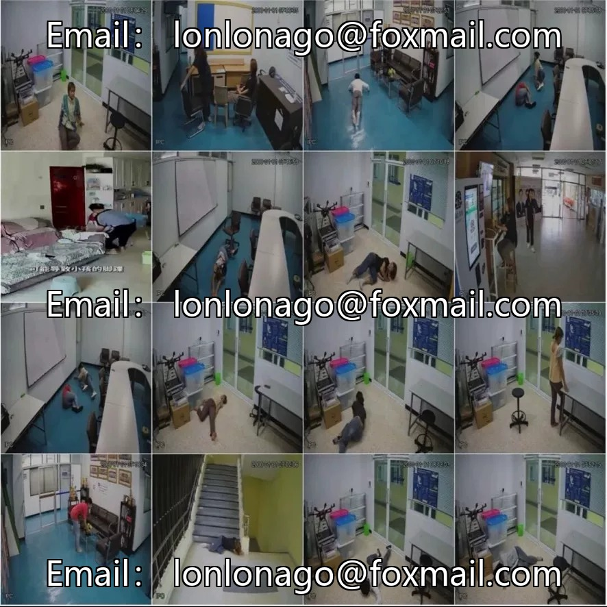
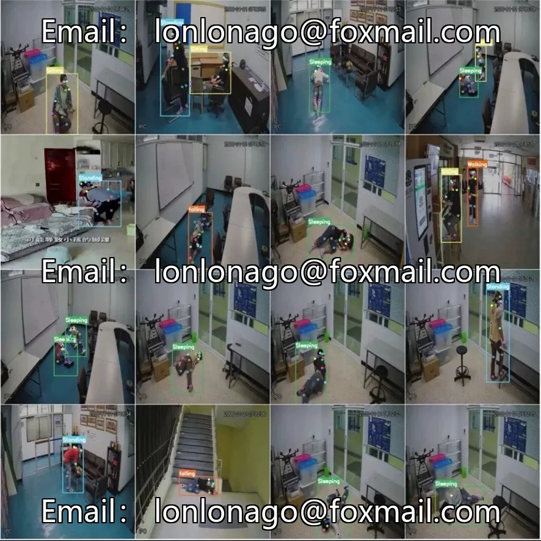

# Human Behavior Posture Estimation Dataset | 7770 images, 6 categories of actions, 18 key points

## Body

Human Behavior Posture Estimation Dataset | 7770 images, 6 categories of actions, 18 key points

The dataset consists of 6 categories: sitting, sleeping, standing, walking, waving, and falling. It includes 18 keypoints (standard COCO 17 points plus neck), in the format of YOLO keypoints, suitable for pose estimation tasks. The resolution is 640×640. The training and validation sets have been divided (7270/500), and a test set needs to be prepared by oneself. The distribution of boxes across the 6 categories is as follows: walking 2570, sleeping 2422, falling 2322, standing 2246, sitting 2000, waving 96 (the sample count is severely insufficient, basically unusable). The other 5 categories have an even distribution.

Fall detection is a core application, with 2322 fall samples and 18 key points, it can accurately judge the body tilt and falling posture. It is suitable for scenarios such as nursing homes, hospitals, and guardianship of elderly people living alone. The number of hand gesture detection samples is small, so gesture interaction scenes should be used with caution.

YOLOv5/8/11/26-pose are all supported, officially stated that can be directly trained. No mAP or other accuracy metrics are required, it needs to be run on its own. Suitable for human posture recognition, behavior analysis, fall alarm systems, intelligent caregiving projects.

Virtual materials, once sold, are non-refundable.
Interested friends, click "I want" to proceed.

## Images

## Payment

Here is a pay link on Stripe ( https://buy.stripe.com/3cs8yP7sY87d0vu9AB ). Please contact me lonlonago@foxmail.com after funding $89, and I will send you a complete data files , thank you!

